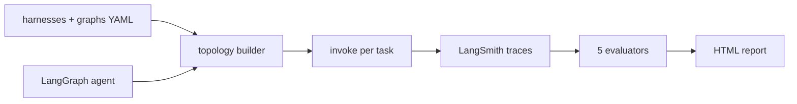

# HarnessLab

[](https://github.com/HOSH19/HarnessLab/actions/workflows/ci.yml)

A/B test **agent harnesses**, **models**, and **graph topologies** on LangGraph agents. Declare variants in YAML, run stress tasks, score with evaluators, compare in `report.html` or LangSmith.

Learning notes (harness → loop → graph): [notes/](notes/).

## What it does

*Did harness X beat harness Y on task Z, and why?*



| Example | Path | Tasks |
|---|---|---|
| Research agent | `examples/research_agent/` | `R-001` to `R-004` (4) |
| Incident manager | `examples/incident_manager/` | `I-101` to `I-109` (9) |

Harness presets: `minimal`, `retry`, `trim` on every example. Both examples also ship `cache` and `circuit_breaker`. Graph presets: `react`, `pipeline`, `supervisor`, `plan_execute` (incident also ships `pipeline_verify`). See [HARNESSES.md](docs/HARNESSES.md) and [GRAPHS.md](docs/GRAPHS.md).

## Quick start

```bash
git clone https://github.com/HOSH19/HarnessLab.git && cd HarnessLab
./scripts/install.sh
cp .env.example .env   # OPENAI_API_KEY; LANGSMITH_API_KEY for upload mode
```

Local (no LangSmith):

```bash
python -m harnesslab compare examples/research_agent --local -o report.html
```

LangSmith upload (drop `--local`):

```bash
python -m harnesslab compare examples/incident_manager \
  --harness cache,circuit_breaker --tasks 6 -o incident-report.html
```

## Commands

| Command | Purpose |
|---|---|
| `compare` | Harness, model, or graph A/B; writes `report.html` with Pareto cost chart |
| `run` | One harness (optional graph) on N tasks |
| `benchmark` | Export compare scores to baseline JSON ([GATE.md](docs/GATE.md)) |
| `gate` | Fail when scores regress vs baseline ([GATE.md](docs/GATE.md)) |
| `dataset upload` | Sync tasks to a LangSmith dataset |

```bash
# Default compare (minimal × 1 task smoke); scale with --harness / --tasks
python -m harnesslab compare examples/research_agent --local -o report.html

# All incident tasks, five harness arms
python -m harnesslab compare examples/incident_manager \
  --tasks 6 --harness minimal,retry,trim,cache,circuit_breaker --local

# Model compare
python -m harnesslab compare examples/research_agent --by models --harness minimal --local

# Graph topology compare
python -m harnesslab compare examples/incident_manager \
  --by graphs --graph react,pipeline,supervisor --harness minimal --local
```

Docs: [HARNESSES.md](docs/HARNESSES.md) · [GRAPHS.md](docs/GRAPHS.md) · [EVALUATORS.md](docs/EVALUATORS.md) · [GATE.md](docs/GATE.md) · [notes/](notes/) · [2026-08-31 worklog](docs/2026-08-31-harness-extensions.md)

MIT License
